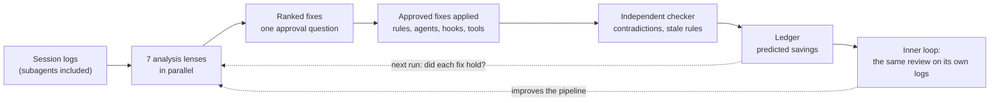

# RSI-inner-loop-outer-loop

**A recursive self-improvement loop for AI coding agents.** Agents repeat the same mistakes, and the human pays for each one with extra prompts. This project reads the Claude Code session logs of a finished project, finds where the human had to repeat, correct or rescue the agent, and turns each pattern into a fix in that project's rules, agents, hooks or tools. The human approves the fixes once, and a ledger checks on the next run whether each fix held.

- **Outer loop:** runs that review on other projects.
- **Inner loop:** runs the same review on this pipeline's own logs, so the tool improves itself.

## Results

- **Benchmark replay:** replaced a 33-prompt, 78-minute manual retrospective with an unattended 32-minute run that found all 10 known issues.
- **On a real project:** on a 135-prompt music video build, it found 48 issues and shipped 14 fixes projected to cut prompts by about 30%.
- **Lessons that fail twice become automatic checks** (for example a Stop hook), instead of one more rule the agent can ignore.

## How it is built

There are no scripts: every stage is done by agents through inference. The whole project is one Claude Code skill, four subagents and seven lens prompts.

| Step | Who | What |
| --- | --- | --- |
| Find | `retro-scout` | Finds every session that worked on the target, measures where the human's prompts and time went, and labels every prompt |
| Analyze | `retro-analyst`, one per lens | Prompt waste, quality, intent, delegation, ignored rules, a hotspot, and follow-up of earlier lessons |
| Propose | the `retro` skill | Merges and ranks the findings into at most 3 change sets, has a checker verify the report, then asks one approval question |
| Apply | `retro-applier` | Applies one approved set to the files it owns, runs the project's tests and commits |
| Check | `retro-checker` | Reads the whole rule set and reports contradictions, repeated rules and stale references, then re-checks the fixes |
| Record | the `retro` skill | Writes the run to the ledger with each fix's predicted savings |

Built with Claude Code (skills, subagents, hooks), multi-agent orchestration, agent evals, prompt engineering and Git.

## Details

Renamed from RSI-session-retro on 2026-10-18 (inner loop: retros of this pipeline; outer loop: retros of other projects, see MANIFEST.md). The old path `antigravity-projects/RSI-session-retro` is a symlink to this folder.

Turns the Claude Code sessions that built a project, subagents included, into fixes the human approves once. The fixes go into that project's guides, agents, hooks and tools. Each run is recorded so the next retro can check whether the fixes held. It works for any project, not only music videos.

There are no scripts. Every stage is done by agents through inference, so the project is one skill, four agents and the lens prompts.

Status: M1–M4 built and tested; M5 written, untested (no AGY/Codex target yet). Run `/retro <project>`. Design: [SPEC.md](SPEC.md). Agents and skill: `claude-config/` (live copies in `antigravity-projects/.claude/`). Test: `evals/slop-replay.md`, and the sync check in `targets/RSI-inner-loop-outer-loop.md`.

Options: `--read-only` (report only, no edits outside `runs/`), `--resume <run>` (pick up a stopped run at its first unfinished stage), `--goal "<text>"` (the report opens with a goal verdict). Saying "the RSI project" ("run the RSI project on AutoJob logs") also starts the skill.

A new or changed agent appears at the next turn boundary, never in a new session; the skill's "Agents" paragraph has the retry steps.

Tested: the Slop replay on 2026-10-14 scored M1 7/8, M2 10/10, M3 pass and M4 5/5, in about 32 minutes with no human prompts. The 10 pipeline fixes it found are untested until the next replay (`evals/slop-replay.md`).
